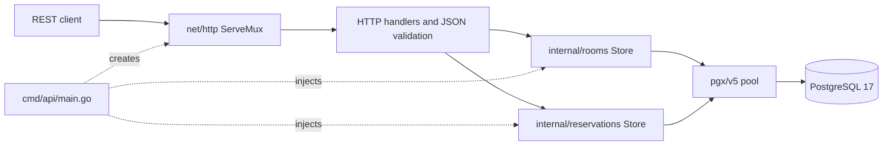
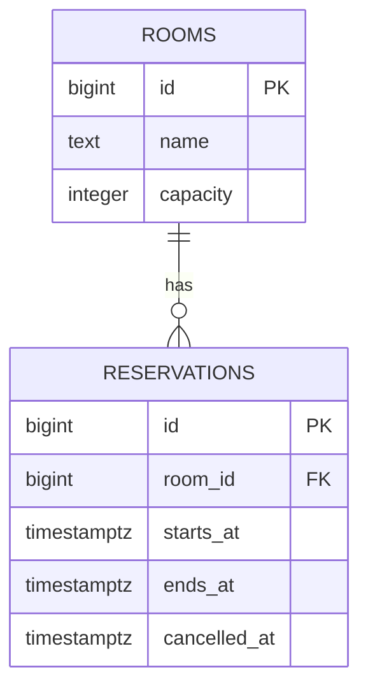
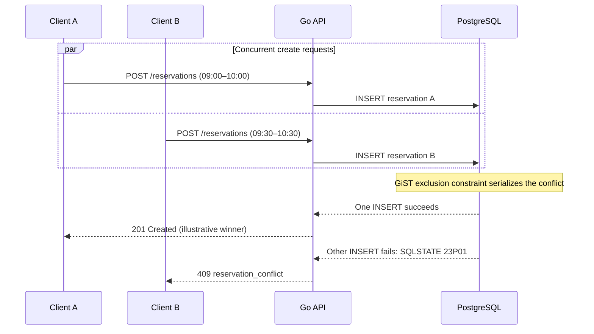

# RoomFlow API — Architecture and design decisions

**English** · [Português (Brasil)](architecture.pt-BR.md) · [Back to README](../README.md)

## Scope

RoomFlow API is a small Go REST backend for room management and reservation scheduling. It deliberately favors explicit SQL and database-backed invariants over framework and ORM complexity. Authentication, authorization, pagination, and a UI are outside the v1.0.0 MVP.

## Component architecture



`cmd/api/main.go` loads environment configuration, creates and pings the connection pool, injects stores into `httpapi.NewHandler`, starts the HTTP server, and handles graceful shutdown. Handlers validate input and translate domain errors to HTTP. Stores use parameterized SQL and accept context. The database enforces relational integrity.

## Data model



Rooms require a nonblank name and positive capacity. Reservations require `ends_at > starts_at` and a valid room foreign key. `ON DELETE RESTRICT` prevents deleting a room with any reservation history, including cancelled reservations. Migration versions are recorded in `schema_migrations`.

## Concurrency: the core invariant

The active-booking exclusion constraint is declared in migration 002:

```sql
CONSTRAINT reservations_no_overlap EXCLUDE USING gist (
    room_id WITH =,
    tstzrange(starts_at, ends_at, '[)') WITH &&
) WHERE (cancelled_at IS NULL)
```

`btree_gist` provides GiST support for scalar room-ID equality. `&&` detects overlapping timestamp ranges, and the partial predicate applies only to active reservations. Adjacent slots do not overlap because the end boundary is exclusive.



The winning client is nondeterministic; the test asserts **one success and one conflict**, using independent connections. The HTTP response translates PostgreSQL error `23P01`, specifically constraint `reservations_no_overlap`, into `409 Conflict`. No application-level preflight query is relied on for correctness.

## Cancellation and lifecycle

The store atomically updates an active record using `UPDATE ... SET cancelled_at = NOW() WHERE id = $1 AND cancelled_at IS NULL RETURNING ...`. A second cancellation returns `409 already_cancelled` and does not overwrite the timestamp. A cancelled row remains queryable and no longer participates in the partial exclusion constraint, so its slot can be booked again.

## API contracts

- `POST /rooms`, `GET /rooms`, `GET /rooms/{id}`, `PATCH /rooms/{id}`, `DELETE /rooms/{id}`.
- `POST /reservations`, `GET /reservations`, `GET /reservations/{id}`, `POST /reservations/{id}/cancel`.
- `GET /healthz` pings PostgreSQL; returns `200` or `503`.
- Successful JSON responses: `{ "data": ... }`; errors: `{ "error": { "code": "...", "message": "..." } }`.
- Timestamps use RFC3339 with explicit offsets and are normalized to UTC in responses. Request JSON rejects unknown or duplicate properties, with a 1 MiB body limit.

See the [OpenAPI 3.1 specification](openapi.yaml) for exhaustive response codes and schemas.

## Verification strategy

Unit tests cover HTTP validation and error mapping. Integration tests exercise SQL stores and HTTP handlers against PostgreSQL. Tests cover overlap and adjacency, cancellation, room deletion restrictions, and nonleaking internal errors. Concurrent creation and concurrent cancellation are tested using independent pool connections. CI applies migrations to a PostgreSQL service and executes regular tests, `go vet`, and Go's race detector. The separate Compose `testdb` uses `tmpfs`; most integration tests roll back their transaction, and independent-connection concurrency tests clean up test data.

## Deployment boundaries

The Docker Compose defaults are suitable for local development, not public production deployment. SQL migrations are manual and rollback scripts are destructive. There is no identity/access control, pagination, resource quotas, or observability stack beyond the health endpoint. These are documented boundaries rather than implemented features.
