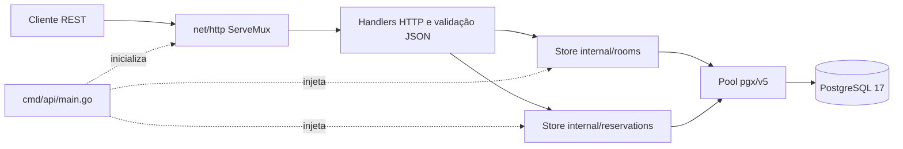
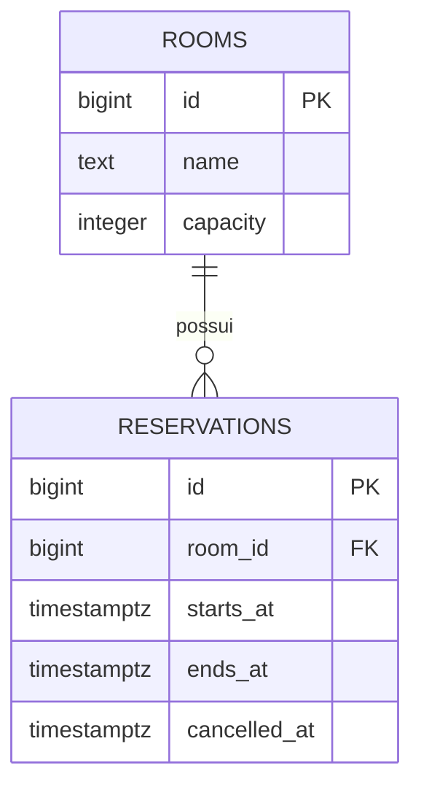
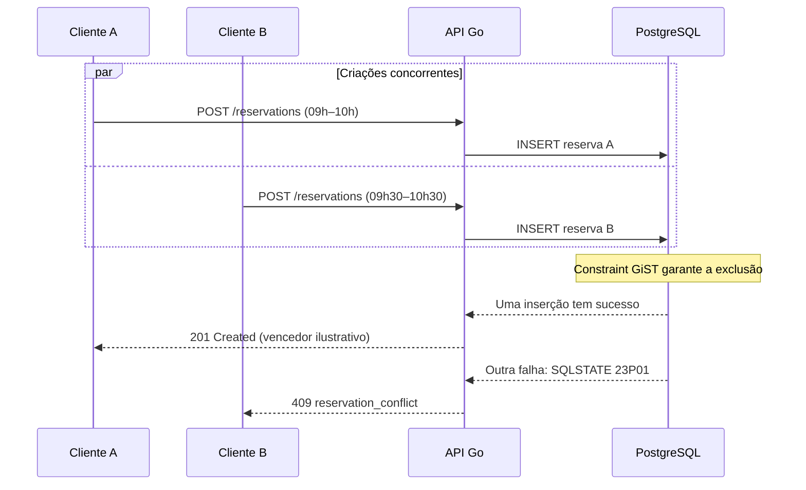

# RoomFlow API — Arquitetura e decisões técnicas

[English](architecture.md) · **Português (Brasil)** · [Voltar ao README](../README.pt-BR.md)

## Escopo

O RoomFlow API é uma API REST enxuta em Go para gerenciamento de salas e agendamento de reservas. A arquitetura prioriza SQL explícito e regras garantidas pelo banco de dados, sem complexidade desnecessária de frameworks e ORMs. Autenticação, autorização, paginação e interface gráfica não fazem parte do MVP v1.0.0.

## Arquitetura de componentes



`cmd/api/main.go` carrega a configuração de ambiente, abre o pool de conexões, verifica o banco, injeta os stores em `httpapi.NewHandler`, inicia o servidor e gerencia seu encerramento seguro. Os handlers validam dados e convertem erros de domínio em respostas HTTP. Os stores executam SQL parametrizado com `context.Context`. O PostgreSQL garante a integridade dos relacionamentos e horários.

## Modelo de dados



Salas exigem nome não vazio e capacidade positiva. Reservas exigem `ends_at > starts_at` e uma sala válida por FK. `ON DELETE RESTRICT` impede excluir salas com qualquer histórico de reservas, inclusive canceladas. As versões das migrations são registradas em `schema_migrations`.

## Concorrência: a regra central

A constraint de exclusão de reservas ativas está na migration 002:

```sql
CONSTRAINT reservations_no_overlap EXCLUDE USING gist (
    room_id WITH =,
    tstzrange(starts_at, ends_at, '[)') WITH &&
) WHERE (cancelled_at IS NULL)
```

A extensão `btree_gist` viabiliza igualdade de IDs no índice GiST. O operador `&&` identifica intervalos sobrepostos e a condição parcial considera apenas reservas não canceladas. Intervalos adjacentes são permitidos porque o fim é exclusivo.



O vencedor não é predeterminado: o teste valida **um sucesso e um conflito** usando conexões independentes. O erro PostgreSQL `23P01` da constraint `reservations_no_overlap` é convertido para `409 Conflict`. Não há dependência de consulta prévia suscetível a corrida para garantir a regra.

## Cancelamento e ciclo de vida

O store cancela de modo atômico com `UPDATE ... SET cancelled_at = NOW() WHERE id = $1 AND cancelled_at IS NULL RETURNING ...`. Um segundo cancelamento retorna `409 already_cancelled` sem sobrescrever o timestamp. A reserva cancelada permanece consultável e deixa de participar da restrição parcial, liberando o período para uma nova reserva.

## Contratos da API

- `POST /rooms`, `GET /rooms`, `GET /rooms/{id}`, `PATCH /rooms/{id}`, `DELETE /rooms/{id}`.
- `POST /reservations`, `GET /reservations`, `GET /reservations/{id}`, `POST /reservations/{id}/cancel`.
- `GET /healthz` consulta a disponibilidade do banco e retorna `200` ou `503`.
- JSON de sucesso: `{ "data": ... }`; erro: `{ "error": { "code": "...", "message": "..." } }`.
- Horários em RFC3339 com fuso explícito, normalizados para UTC nas respostas. O JSON rejeita propriedades desconhecidas ou repetidas e tem limite de 1 MiB.

Consulte o [OpenAPI 3.1](openapi.yaml) para schemas e respostas completas.

## Estratégia de testes

Testes unitários cobrem validações HTTP e tradução de erros. Testes de integração exercitam stores SQL e handlers HTTP contra PostgreSQL real. Os cenários cobrem sobreposição, adjacência, cancelamento, bloqueio de exclusão de salas e proteção contra vazamento de detalhes internos. A criação e o cancelamento concorrentes são testados com conexões independentes. Na CI, um serviço PostgreSQL recebe as migrations e executa os testes, `go vet` e detector de corridas. O `testdb` do Compose usa `tmpfs`; a maioria dos testes integrais faz rollback e os testes concorrentes removem os próprios registros.

## Limites de implantação

O Compose usa credenciais próprias de desenvolvimento local; não configura exposição pública segura. As migrations são manuais e suas reversões apagam dados. O MVP não inclui controle de identidade/permissões, paginação, cotas ou observabilidade além do health check. São limitações declaradas, não funcionalidades existentes.
